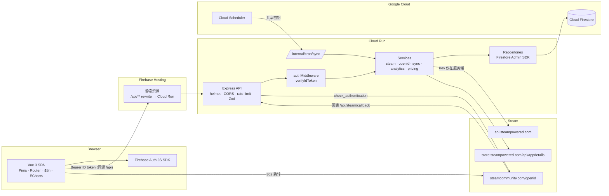
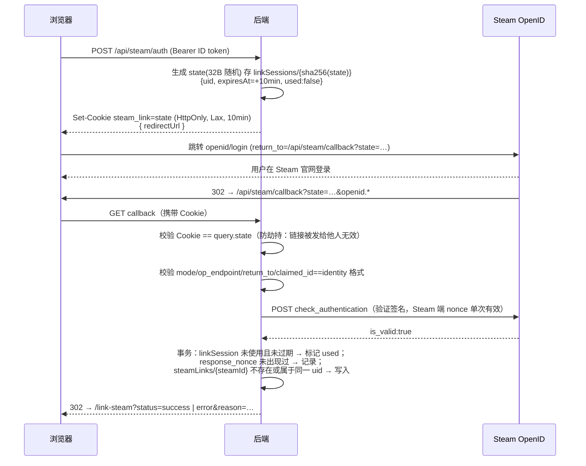

# Steam Analytics Dashboard — 第一阶段：架构设计

本文档是动手实现前的架构说明，涵盖：可行性评估、架构图、Firestore 数据模型、API 设计与开发计划。
源代码标识符、API 名称、数据库字段一律使用英文。

---

## 1. 可行性评估

### 1.1 已核实的外部接口（2026-10-26 实测）

| 接口 | 是否需要 Key | 实测结论 |
|---|---|---|
| `https://steamcommunity.com/openid/` | 否 | 返回 XRDS，OP Endpoint 为 `https://steamcommunity.com/openid/login`（OpenID 2.0） |
| `ISteamUser/GetPlayerSummaries/v2` | 是 | 官方文档接口 |
| `IPlayerService/GetOwnedGames/v1` | 是 | 官方文档接口；支持 `include_appinfo`、`include_played_free_games`；返回 `playtime_forever`（分钟）、`playtime_2weeks`、`rtime_last_played` |
| `IPlayerService/GetRecentlyPlayedGames/v1` | 是 | 官方文档接口 |
| `IPlayerService/GetSteamLevel/v1` | 是 | 官方文档接口 |
| `ISteamUserStats/GetPlayerAchievements/v1` | 是 | 官方文档接口；游戏无统计数据或资料私密时返回错误 |
| `ISteamUserStats/GetSchemaForGame/v2` | 是 | 官方文档接口；提供成就名称、描述、图标 |
| `ISteamUserStats/GetGlobalAchievementPercentagesForApp/v2` | 否 | 实测可用；返回全局解锁率 |
| `store.steampowered.com/api/appdetails` | 否 | **非 Steamworks 正式文档接口**，但为 Steam 商店自身使用的公开接口。实测：多 appid + `filters=price_overview` 可批量取价；免费游戏返回 `data: []`；不存在/下架返回 `success:false`；单 appid + `filters=basic,price_overview` 返回 `type`、`is_free` |

> 关于定价：Steamworks Web API 没有面向第三方的"商店价格"官方文档接口，`appdetails` 是业界唯一可行且合法的公开数据源。系统将其明确标注为"Steam 商店公开数据（非官方 API，可能变更）"，并做了严格的限流（约 200 次/5 分钟）、缓存与失败降级。

### 1.2 字段可得性分类

图例：**A** 直接可得；**B** 受隐私/API 条件限制；**C** 可由现有数据推导；**D** 仅能估算；**E** 官方接口不可得。

| 需求字段 | 分类 | 来源 / 说明 |
|---|---|---|
| 头像、昵称、SteamID64、个人资料 URL | A | GetPlayerSummaries |
| 在线状态 | A | `personastate`（私密资料时只返回 Offline，需提示"可能不准确"） |
| 当前正在玩的游戏 | B | `gameextrainfo/gameid`，仅在资料公开且"游戏详情"公开时返回 |
| Steam 等级 | B | GetSteamLevel，私密资料可能返回空 |
| 拥有游戏数、各游戏时长 | B | GetOwnedGames，要求"游戏详情"公开；否则返回空对象 → 显示"不可用（资料私密）"，**不显示 0** |
| 近两周时长 | B | `playtime_2weeks`，缺失即为两周内未玩（Steam 的语义），与"不可用"区分 |
| 最后游玩时间 | B | `rtime_last_played`；值为 0 表示 Steam 未记录 → 显示"不可用" |
| 封面图 | A | Steam CDN `.../apps/{appid}/header.jpg`（静态 URL 规则，加载失败时回退占位图） |
| 成就总数、已解锁数、解锁时间 | B | GetSchemaForGame + GetPlayerAchievements；游戏不支持成就 / 资料私密时显示"无成就数据" |
| 成就全局解锁率 | A | GetGlobalAchievementPercentagesForApp |
| 成就完成率 | C | 已解锁 / 总数（仅限有成就数据的游戏） |
| 总时长（小时） | C | Σ playtime_forever / 60 |
| 当前商店价格 | D | appdetails `price_overview`，按地区（`cc`）返回当地货币 |
| 游戏库估值 | D | Σ 已知价格；未知价格单独计数，**不当作 0** |
| 每小时成本（估算） | C/D | 估算价格 / 小时数；时长为 0 显示"未游玩" |
| 历史购买价格 | E | 官方 Web API 不提供 → 用户手动录入（标注"用户自填，未经验证"） |
| 每日/每月时长趋势 | E（历史）/ C（追踪后） | Steam 只有累计时长；本系统从开始追踪起定期保存快照并计算差值，**不回溯捏造** |
| 汇率换算 | E | 不引入未声明来源的汇率；不同货币分组展示，绝不混合求和 |

### 1.3 主要风险

1. **隐私设置**：大量用户"游戏详情"为私密，必须完整处理"不可用"状态。
2. **限流**：Web API 每 Key 每日 100,000 次；商店接口约 200 次/5 分钟。大型游戏库（数千款）的成就与价格同步必须分批、可续跑。
3. **后台任务**：Cloud Run 默认在响应后限制 CPU。同步任务需要使用"实例级计费（CPU 始终分配）"，或通过 Cloud Scheduler 定期触发续跑（本项目两者都支持）。
4. **appdetails 非正式接口**：可能变更，所有解析均经 Zod 校验，失败时标记为 `unknown` 而不是错误数据。

---

## 2. 架构图



关键决策：

- **同源部署**：Firebase Hosting 将 `/api/**` 重写到 Cloud Run，开发时由 Vite 代理 `/api`。这样 Steam 关联的绑定 Cookie 可以使用 `SameSite=Lax; HttpOnly; Secure`，无需跨站 Cookie，CORS 只需放行自身源。
- **前端只通过后端 API 访问数据**；Firestore 规则仍作为纵深防御完整定义（拒绝跨用户访问、禁止客户端写入可信 Steam 数据）。
- **分层**：routes → controllers → services → repositories；Steam HTTP 客户端独立封装超时、退避重试和按主机令牌桶限流。
- **shared 包**：Zod schema 与 TypeScript 类型、统计计算纯函数在前后端共用，保证口径一致并便于单测。

### 2.1 Steam 账号关联流程（防 CSRF / 重放 / 劫持）



- 取消授权：Steam 以 `openid.mode=cancel` 回调 → `reason=cancelled`。
- 冲突：SteamID 已绑定其他账户 → `reason=already_linked`（不提供自动转移；需原账户先解绑）。
- 关联需要已验证邮箱（`REQUIRE_EMAIL_VERIFIED=true`，可配置）。

---

## 3. Firestore 数据模型

```
users/{uid}                                  UserDoc（客户端可读；仅可改 displayName / preferences）
users/{uid}/steamProfile/current             SteamProfileDoc（仅后端写）
users/{uid}/games/{appid}                    OwnedGameDoc（仅后端写）
users/{uid}/games/{appid}/achievements/state PlayerAchievementStateDoc（仅后端写，单文档存 map）
users/{uid}/gamePurchases/{appid}            PurchaseDoc（用户可写，规则校验字段）
users/{uid}/playtimeSnapshots/{YYYY-MM-DD}   PlaytimeSnapshotDoc（仅后端写）
users/{uid}/syncJobs/{jobId}                 SyncJobDoc（仅后端写）
steamLinks/{steamId64}                       SteamLinkDoc（客户端不可访问）— 唯一性映射
linkSessions/{sha256(state)}                 LinkSessionDoc（客户端不可访问，TTL）
openidNonces/{sha256(nonce)}                 NonceDoc（客户端不可访问，TTL）
steamApps/{appid}                            AppMetadataDoc（共享：type/is_free/名称）
steamApps/{appid}/prices/{cc}                AppPriceDoc（共享：分地区价格缓存）
steamApps/{appid}/schemas/{lang}             AchievementSchemaDoc（共享：成就定义 + 全局解锁率）
```

与建议结构的差异及理由：

- **成就状态按游戏存为单文档**（`achievements/state`，内含 `{ apiName: unlockTime }` map），而不是每个成就一个文档：一个 100 成就的游戏，同步写入从 100 次降为 1 次，读取同理。成就的名称/图标/描述属于游戏而非用户，放在共享集合 `steamApps/{appid}/schemas/{lang}`，所有用户复用缓存。
- **快照按天作为文档 ID**：同一天多次同步只覆盖当天快照，天然去重；文档内存储 `{ appid: playtimeMinutes }`，1MB 限制足以容纳上万款游戏。
- **读取优化**：库/分析接口在后端按 `uid + librarySyncVersion` 做内存 LRU 缓存；每次请求只需读 1 次 `users/{uid}` 来判断缓存是否失效。同步时只写入发生变化的游戏文档。
- **TTL**：`linkSessions.expiresAt`、`openidNonces.expiresAt` 配置 Firestore TTL 策略自动清理。

完整 TypeScript 接口见 `shared/src/models.ts`，规则见 `firebase/firestore.rules`，索引见 `firebase/firestore.indexes.json`。

---

## 4. API 设计

所有响应统一为：

```jsonc
// 成功
{ "data": { ... }, "meta": { "cachedAt": "...", "source": "cache" } }
// 失败
{ "error": { "code": "STEAM_PROFILE_PRIVATE", "message": "...", "details"?: ... } }
```

除 `/api/health`、`/api/steam/callback`、`/internal/*` 外，所有接口都要求 `Authorization: Bearer <Firebase ID token>`。

| 方法 | 路径 | 说明 |
|---|---|---|
| GET | `/api/health` | 健康检查 |
| GET | `/api/me` | 当前用户资料（首次调用时创建 users 文档、更新 lastLoginAt） |
| PATCH | `/api/me` | 修改 displayName / preferences（Zod 校验） |
| DELETE | `/api/me` | 删除账户：要求 5 分钟内重新认证（`auth_time`）；删除全部子集合、Steam 映射与 Auth 用户 |
| POST | `/api/steam/auth` | **调整**：原 GET 改为 POST。浏览器跳转无法携带 Bearer token，因此先用 POST 建立关联会话并下发绑定 Cookie，返回 `redirectUrl` |
| GET | `/api/steam/callback` | Steam OpenID 回调（无 Bearer，靠 state + Cookie + 签名校验） |
| DELETE | `/api/steam/link` | 解绑（事务删除映射，清除 Steam 缓存数据，保留用户自填购买记录） |
| GET | `/api/steam/profile` | Steam 资料；在线状态 60 秒内缓存，过期则实时刷新 |
| GET | `/api/steam/games` | 游戏库：`q, sort, order, played, achievements, page, pageSize` |
| GET | `/api/steam/games/:appid` | 游戏详情（含价格、购买记录、成本） |
| GET | `/api/steam/games/:appid/achievements` | 成就列表（按需同步，带缓存） |
| POST | `/api/steam/sync` | `{ scope: "profile" \| "full" }`，同一用户同时只允许一个任务（事务锁） |
| GET | `/api/steam/sync/status` | 当前/最近任务状态与最近成功同步时间 |
| GET | `/api/analytics/overview` | 总览指标 |
| GET | `/api/analytics/playtime` | 时长分布、Top10、已玩/未玩、快照趋势 |
| GET | `/api/analytics/achievements` | 成就统计 |
| GET | `/api/analytics/library-value` | 模型 A 估值 + 模型 B 自填花费（按货币分组） |
| GET | `/api/analytics/cost-efficiency` | 每小时成本（估算 / 实际），最高与最低 |
| GET | `/api/purchases` | 自填购买记录 |
| PUT | `/api/purchases/:appid` | 新增/修改（必须是已拥有的游戏） |
| DELETE | `/api/purchases/:appid` | 删除 |
| POST | `/internal/cron/sync` | Cloud Scheduler 调用（`X-Cron-Secret`，常量时间比较） |

错误码：`UNAUTHENTICATED`、`FORBIDDEN`、`EMAIL_NOT_VERIFIED`、`RECENT_LOGIN_REQUIRED`、`VALIDATION_FAILED`、`NOT_FOUND`、`STEAM_NOT_LINKED`、`STEAM_ALREADY_LINKED`、`STEAM_PROFILE_PRIVATE`、`STEAM_UNAVAILABLE`、`SYNC_IN_PROGRESS`、`RATE_LIMITED`、`INTERNAL`。

---

## 5. 开发计划

| 阶段 | 内容 | 交付物 |
|---|---|---|
| 1 架构 | 接口核实、风险、数据模型、API 契约 | 本文档、`shared/src/*` |
| 2 基础 | monorepo、Express 骨架与中间件、Firebase Auth（注册/登录/验证/重置/删除）、UI 设计系统 | `backend/src/app.ts`、`frontend/src/components/ui/*` |
| 3 Steam | OpenID 关联、资料、游戏库、成就服务、同步与缓存、限流退避 | `backend/src/services/*` |
| 4 分析 | 统计计算、估值 A/B、每小时成本、ECharts 可视化 | `shared/src/analytics.ts`、`frontend/src/views/*` |
| 5 质量 | 单元/集成/规则测试、安全审计、部署文档 | `backend/test/*`、`docs/deployment.md` |
